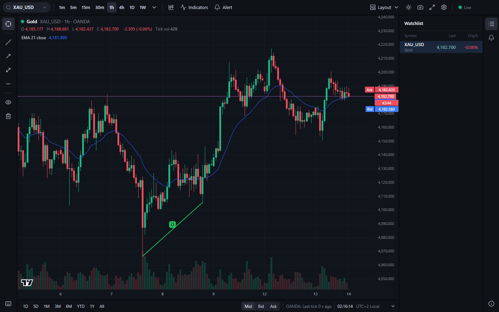
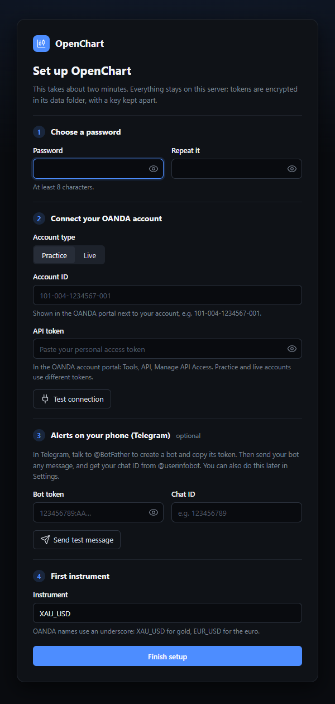
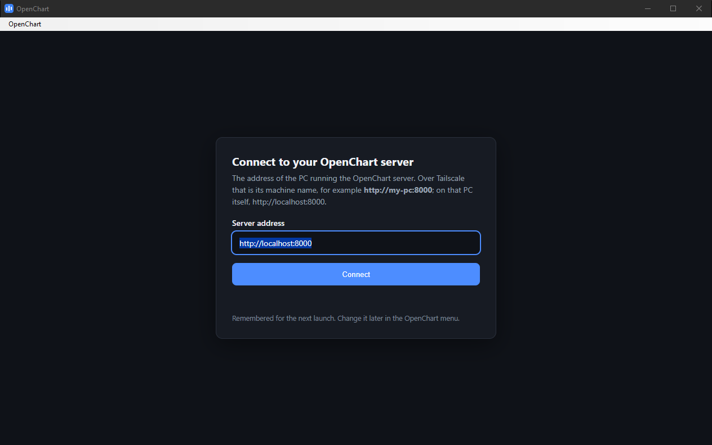

# OpenChart

Self-hosted charting and alerting server for forex and metals. It runs 24/7 on your own PC, pulls prices from your own broker account, and pushes alerts on drawn lines (including sloped trendlines) to your phone, even when no chart is open.

> **Status:** usable for charting and alerts on gold (XAU_USD) with an OANDA account; still young. See [What works](#what-works).



## Important

- **Independent project.** OpenChart is not affiliated with, endorsed by or sponsored by TradingView, Inc. It uses the open-source TradingView Lightweight Charts library under its Apache 2.0 license (see `NOTICE`).
- **Not financial advice.** OpenChart is a charting and alerting tool. Nothing it shows or sends is a recommendation to trade.
- **No warranty.** Provided "as is" under the Apache License 2.0. Alerts can be late or missed (network loss, broker outages, bugs). Use at your own risk.
- **Your data, your credentials.** OpenChart ships no market data. Each install pulls prices with the user's own broker credentials.

## Quickstart (Windows, about 10 minutes)

You need: a Windows 10 or 11 PC that stays on (the server), an OANDA account (a free practice account is fine), and optionally Telegram on your phone and Tailscale for access from your other devices. No Python, no command line knowledge.

### 1. Download

From the [Releases page](https://github.com/yannis-montreer/OpenChart/releases), on the PC that will run the server:

- `OpenChart-Server-<version>-windows.zip`: the server, the Windows service scripts and NSSM.
- `OpenChart-Viewer-<version>-windows.zip` (optional): a desktop window for your other PCs. Any browser works too.

Before extracting, right-click the zip, **Properties**, tick **Unblock**, OK. Extract the server to a permanent place, for example `C:\OpenChart` (not Downloads: the service runs from there).

The programs are not code-signed. The first time you start one, Windows SmartScreen says "Windows protected your PC": click **More info**, then **Run anyway**. The `SHA256SUMS.txt` file on the release lets you check the downloads (`Get-FileHash <file>` in PowerShell).

### 2. Get an OANDA practice token (2 minutes)

1. Open a free practice (demo) account on [oanda.com](https://www.oanda.com/) if you do not have one, and log in to the OANDA hub.
2. Go to **Tools**, **API**, **Manage API Access**, and **Generate** a personal access token. Copy it; it is shown once.
3. Note your **account ID** (format `101-004-1234567-001`), shown next to the practice account.

Practice and live accounts have different tokens. Run one OpenChart server per OANDA account: OANDA allows only a couple of price streams per practice account.

### 3. Install the service (2 minutes)

In `C:\OpenChart`, double-click **`install-service.cmd`** and accept the administrator prompt. It:

- installs the **OpenChart** Windows service: it starts with Windows and restarts by itself if it stops,
- keeps your data in `C:\ProgramData\OpenChart\data` (logs in its `logs` folder),
- opens port 8000 in the Windows Firewall for Tailscale addresses only (`100.64.0.0/10`),
- warns if the PC is set to sleep, and shows the two `powercfg` commands that stop it (a sleeping PC sends no alerts; they arrive late when it wakes).

It ends with "Running" and the addresses to use. To change the port or the data folder, run `install-service.ps1 -Port 8080 -DataDir D:\OpenChart` instead (`Get-Help .\install-service.ps1 -Full` lists the options).

### 4. Set up OpenChart (2 minutes)

On the server PC, open **http://localhost:8000**. The setup page asks for:

1. a password for OpenChart,
2. your OANDA account type, account ID and token (**Test connection** checks them),
3. optionally Telegram (next step; you can also add it later in Settings),
4. the first instrument: `XAU_USD` for gold.



Click **Finish setup**: the chart opens and gold's history downloads in the background, two years of minute bars, usually a few minutes (the top bar says "Downloading" until it is done, and the chart reloads by itself). The tokens are kept encrypted in the data folder, with a key only Windows administrators can read.

### 5. Telegram alerts on your phone (2 minutes, optional)

1. In Telegram, talk to **@BotFather**, send `/newbot`, pick a name: it gives you a **bot token**.
2. Send any message to your new bot (otherwise it cannot write to you).
3. Talk to **@userinfobot**: it replies with your **chat ID**.
4. In OpenChart, **Settings** (gear, top right), **Telegram**: paste both, click **Send test message**.

Alerts on lines and levels then reach your phone even when no chart is open, and the server tells you when it starts, when the price feed stalls and recovers, and when the PC was asleep.

### 6. Your phone and other PCs: Tailscale (3 minutes)

[Tailscale](https://tailscale.com/) connects your devices privately; nothing is opened to the internet.

1. Install Tailscale on the server PC and on each phone or PC you want to use, and sign in with the **same account** on all of them.
2. On the server PC, in Tailscale's settings, turn on **Run unattended** (so it stays connected when nobody is logged in).
3. In the [Tailscale admin console](https://login.tailscale.com/admin/machines): on the server machine's **...** menu choose **Disable key expiry**, and under **DNS** make sure **MagicDNS** is on.
4. On your phone or other PC, open **http://&lt;server PC name&gt;:8000** (the name shown in the admin console, for example `http://my-pc:8000`) and log in.

Do not forward port 8000 on your router. The firewall rule only lets Tailscale addresses in; the OpenChart password is a second lock.

### 7. The desktop viewer (optional)

Extract `OpenChart-Viewer-<version>-windows.zip` anywhere and run `OpenChart-Viewer.exe`. The first time, it asks for the server's address (`http://my-pc:8000` over Tailscale, `http://localhost:8000` on the server itself) and remembers it; change it later in its **OpenChart** menu. It keeps you logged in like a browser.



It needs the **Microsoft Edge WebView2 Runtime**, which Windows 11 and up-to-date Windows 10 already have. If it is missing, the viewer says so and offers Microsoft's download page (take the Evergreen Bootstrapper) or opening OpenChart in your browser instead.

### Updating, backups, removing

- **Update:** extract the new server zip to a new folder and run its `install-service.cmd`: it stops the service, points it at the new version and starts it again. Your data and settings stay. Then delete the old folder.
- **Back up:** `C:\OpenChart\openchart\openchart.exe backup --data-dir C:\ProgramData\OpenChart\data` writes one zip (safe while the server runs) and prints where. Keep `C:\ProgramData\OpenChart\secret.key` somewhere safe too: the tokens in a backup can only be read with it (or you enter them again).
- **Remove:** `uninstall-service.cmd` removes the service and its firewall rule and keeps the data and key.

### Moving an existing install into the service

If you ran OpenChart yourself before (for example `openchart run` in a source checkout, with its `data` folder), this moves everything into the service. That means history, ticks, drawings, alerts with their state and log, layouts, settings, your indicator files and your password. The original folder is not changed, so it stays your way back. About 10 minutes.

How the tokens move: the source install keeps them in your Windows Credential Manager, under the name of its database (`OpenChart/<instance id>`). The service keeps them in `secrets.enc` in its data folder. The installer copies them from the first to the second, for the database it finds in the service's data folder. So copy the database first, then run the installer again, from your own Windows account.

1. **Note what you have.** In the source checkout, while it still runs, look at the Alerts panel. Then stop it and run `.venv\Scripts\openchart.exe stats`. Keep the output: the candle counts and the line `Drawings: N, alerts: N (N active), layouts: N` are what you compare at the end.
2. **Stop the source server:** Ctrl+C in its window, or close it. `Get-NetTCPConnection -LocalPort 8000 -State Listen` must print nothing: one server per OANDA account.
3. **Back it up:** `.venv\Scripts\openchart.exe backup --data-dir .\data --out C:\OpenChart-move`. It prints the zip's path.
4. **In PowerShell as administrator, stop the service and put its current data aside.** Keep it as a folder: never mix files of two databases, because an old `openchart.db-wal` next to a new `openchart.db` would damage it.
   ```powershell
   Stop-Service OpenChart
   Rename-Item C:\ProgramData\OpenChart\data data.before-move
   New-Item -ItemType Directory C:\ProgramData\OpenChart\data | Out-Null
   Get-Acl C:\ProgramData\OpenChart\data.before-move | Set-Acl C:\ProgramData\OpenChart\data
   ```
   The last line gives the new folder the same restricted access as the old one.
5. **Unpack the backup into it** (the zip step 3 printed):
   ```powershell
   Expand-Archive C:\OpenChart-move\openchart-backup-<date>-<time>.zip -DestinationPath C:\ProgramData\OpenChart\data
   Remove-Item C:\ProgramData\OpenChart\data\backup.json
   ```
6. **Run `install-service.cmd` again**, from your own Windows account, and accept the administrator prompt. Use the same options as before if you changed any, such as `-Port`. It reuses the key file, copies your tokens from the Credential Manager into the new `secrets.enc`, and starts the service. Its output must say `Copied from the Credential Manager: oanda_token, telegram_token`. If it says `nothing`, the tokens were only in a `.env` file: enter them in Settings after step 7.
7. **Check:**
   - `C:\ProgramData\OpenChart\data\logs\service.log`, near the end: `secrets: encrypted file ...; oanda_token set, telegram_token set`, then the feed connecting.
   - Telegram: `OpenChart alert engine started: watching N active alerts`, with your N from step 1.
   - http://localhost:8000: log in with your usual password (browsers that were logged in stay logged in). Your drawings and their bells are there, and the Alerts panel lists your alerts as Active with their log. The layout menu has your layouts, and the starred one loads.
   - `C:\OpenChart\openchart\openchart.exe stats --data-dir C:\ProgramData\OpenChart\data` prints the same counts as step 1, with more candles if the market moved meanwhile.
   - Any alert that would have fired while both were stopped arrives late, marked "after a restart": the service replays the missed minutes when it starts.
8. **Afterwards:** do not start the source server again: it would be a second price stream on your OANDA account and would send the same alerts twice. When you are happy, delete `C:\ProgramData\OpenChart\data.before-move` and `C:\OpenChart-move`. Keep the source `data` folder as long as you want a way back.

**Going back:** `Stop-Service OpenChart`, then start the source server again. It continues from where it stopped. Anything done in the service since then (new drawings, fired alerts) is not in it, and alerts the service already sent may be sent again when the source server catches up on the missed minutes.

### If something does not work

- The log: `C:\ProgramData\OpenChart\data\logs\service.log`. Its first lines say where the tokens come from and whether they are set.
- `openchart\openchart.exe self-test` checks that every part of the program works on this PC.
- The page does not open from your phone: check that Tailscale is connected on both devices and that you use the server PC's Tailscale name. On the server PC itself, http://localhost:8000 must work.

### Docker (Linux servers, NAS)

`docker-compose.yml` runs the same server in a container, with the data in a volume and a health check:

```bash
docker compose build
docker run --rm openchart:local openchart secrets new-key   # put it in .env as OPENCHART_SECRET_KEY=...
docker compose up -d
docker compose logs openchart                              # shows the setup code for the first visit
```

By default it listens on `127.0.0.1:8000` of the host. Set `OPENCHART_BIND` in `.env` to your Tailscale IP (or `0.0.0.0`) to reach it from other devices, and `OPENCHART_PORT` to change the port. The key in `.env` encrypts the tokens you enter in the setup page; keep it. Back up with `docker compose exec openchart openchart backup` (the zip lands in `/data/backups` inside the volume).

### Running the service from a source checkout

If you run OpenChart from a clone of this repository (see Development setup below), the same script installs the service around it, keeping your data folder and copying your tokens from the Credential Manager:

```powershell
.\packaging\windows\install-service.ps1 -Exe .\.venv\Scripts\openchart.exe -DataDir .\data -Nssm C:\path\to\nssm.exe
```

NSSM 2.24 is at https://nssm.cc/download (or `winget install NSSM.NSSM`). Stop any `openchart run` you started yourself first: one server per OANDA account.


## What works

| Milestone | Status |
|---|---|
| M0 Scaffolding: package layout, config, SQLite migrations, tests, CI | done |
| M1 OANDA provider, storage, backfill | done |
| M2 Aggregation, live candles, API, websocket | done |
| M3 Web chart | done |
| M4 Setup wizard, login, settings | done |
| M5 Drawings | done |
| M6 Alerts and Telegram | done |
| M7 Indicators, chart types, layouts | done (reduced scope: EMA only) |
| M8 Packaging and deployment | done, waiting on owner acceptance checks |
| M9 Second instrument (EURUSD) | not started |

## Development setup

Requires Python 3.11 or later, and Node.js 24 for the web interface.

```bash
python -m venv .venv
.venv\Scripts\activate          # Windows
# source .venv/bin/activate     # Linux / macOS
pip install -e ".[dev]"
pytest
ruff check . && ruff format --check .
```

Build the web interface once (and again after pulling frontend changes); the server serves it at http://127.0.0.1:8000:

```bash
cd frontend
npm ci
npm run build
```

For frontend work, `npm run dev` serves it with live reload on http://127.0.0.1:5173 and forwards `/api` and `/ws` to a server on port 8000 (set `OPENCHART_API` to use another). `npm test` runs the frontend unit tests.

## First start (from source)

Run `openchart run` and open http://127.0.0.1:8000. The setup wizard asks for:

1. a password for the web interface,
2. your OANDA account type, account ID and API token (with a Test connection button),
3. optionally a Telegram bot token and chat ID for phone alerts (with a Send test message button),
4. the first instrument (default XAU_USD).

No file editing is needed. When you run the server yourself, tokens are stored in the operating system's credential store (Windows Credential Manager); the Windows service and Docker keep them in an encrypted file in the data folder instead (`secrets.enc`, with the key kept outside it). Never in plain text or in the database, and the web interface only ever shows their last four characters. Everything can be changed later in Settings (gear icon, top right): password, broker credentials, Telegram, instruments, tick storage, alert timezone, and access from other devices.

- Opening the wizard from another device before setup asks for a one-time setup code printed in the server's console.
- A login lasts 30 days per browser. Failed logins are rate limited.
- Forgot the password? On the server run `openchart reset-password`.
- Docker or headless Linux without a credential store: set `OPENCHART_SECRET_KEY` (a Fernet key) and tokens go to an encrypted file in the data folder instead.

Configuration can still come from environment variables or a `.env` file (see `.env.example`), for headless installs. Values saved in the web interface take precedence. `.env` is git-ignored; never commit it.

## Command line

Fill in `.env` first (OANDA practice token and account ID), then:

```bash
openchart test-connection          # one live call, prints OK or the error
openchart backfill XAU_USD         # 2 years of M1 (default); add --years N to change
openchart backfill XAU_USD --deep  # also H1 back to the broker's first candle (gold: 2006)
openchart stats                    # rows, range, coverage, H1 depth, cached bars
openchart rebuild-cache            # recompute cached 4h/D/W bars (never needed normally)
openchart reset-password           # set a new web password from the server console
openchart gaps XAU_USD             # holes not explained by weekends or the daily break
openchart repair XAU_USD           # refetch those holes from the broker (fills what it has)
openchart run                      # start the server: API, websocket and live feed
openchart backup                   # one zip of the data folder, safe while the server runs
openchart secrets status           # where the tokens are kept, and which are set
openchart self-test                # check offline that every part of this install works
```

- `backfill` is idempotent and resumable: run it again and it only fetches what is missing. A larger `--years` later extends history backwards.
- `run` starts the server on http://127.0.0.1:8000 (change with `--host`/`--port`). It fills any gap since the last stored candle, streams ticks, builds live candles for every timeframe, saves closed M1 bars and raw ticks, and logs feed status every minute. If the link drops or goes silent for 15 s, it reconnects with backoff and gap-fills from REST. Once a minute it re-fetches the last 15 minutes of M1 from OANDA so stored history matches the broker's candles exactly.
- By default the server only accepts connections from this computer. To reach it from your phone or another PC (over Tailscale), turn on Settings, Network, "Allow other devices to connect" and restart the server, or start it with `--host 0.0.0.0`.
- Run **one** server per OANDA account. OANDA limits concurrent price streams per account (about two on practice); an extra stream request is left unanswered and the log says "no answer to the stream request".
- Open http://127.0.0.1:8000 for the chart (after building the web interface, see above).
- REST and WebSocket reference: [`docs/api.md`](docs/api.md). Try http://127.0.0.1:8000/api/candles?instrument=XAU_USD&timeframe=1h&limit=5 or the interactive docs at http://127.0.0.1:8000/docs.
- `pytest -m live -v` runs a few checks against the real OANDA API using your `.env`.

### What works / what does not

Works:
- OANDA candles (paginated, retried, complete only), pricing stream with heartbeat supervision and reconnect, SQLite M1 storage, idempotent and resumable backfill, gap-fill on start and after reconnect, gap report, Parquet tick storage (M1).
- All timeframes from 1s to 1W. 4h, daily and weekly bars use the 17:00 New York trading day and follow DST; derived daily and 4h bars match OANDA's own candles exactly, checked on both 2025/2026 DST changes (M2).
- Live candles from ticks for every timeframe, REST candles (`mid`, `bid`, `ask`), websocket with ticks, live candles and feed status (M2).

- Web chart (M3): live candles for every timeframe, history that loads further back as you scroll left, crosshair with OHLC legend, Bid/Ask lines with a bar-close countdown, tick volume, mid/bid/ask switch, date ranges, display timezone, dark and light theme, watchlist, connection and feed status, keyboard shortcuts, screenshot, full screen. After a dropped connection (or a server restart) it catches up without reloading, including bars that formed while it was away. Usable on a phone for reading the chart.

- Setup, login and settings (M4): first-run wizard with connection tests, single-password login (argon2, 30-day HTTP-only session cookie, rate limited), settings page, instruments added and removed from the UI (history downloads in the background), secrets in the OS credential store and never returned by the API.

- Drawings (M5): horizontal line, trendline, ray and extended line from the left toolbar. Click point 1, click point 2 (or press, drag, release); hover shows the handles; drag a handle or the whole line; Delete removes; right-click for style, label, clone and delete; a floating toolbar sets colour, width and dash. Hold Ctrl while drawing to snap to the bar's open, high, low or close. Drawings are stored on the server and every open browser sees changes at once. The eye hides them; the bin deletes all of them on the instrument.

- Alerts (M6): right-click a line and choose Add alert (or select it and press Alt+A, or use the Alert button; without a selected line the alert is on a price level). Crossing, crossing up or down; once, once per bar, on bar close or at most once a minute; bid, mid or ask; an expiry. Alerts run in the server whether a browser is open or not, on exactly the line drawn, and go to Telegram (set it up in Settings) and to open browsers. The bell in the right column lists them (stop, restart, edit, delete) with a log of what fired and whether Telegram got it. If the computer slept, the feed dropped or the server was off, the missed minutes are checked as soon as it is back and those alerts arrive marked as late; after sleep Telegram also tells you how long the server was frozen. Telegram also gets "engine started" and "feed stalled" / "feed recovered" messages.

- Indicators (M7): the Indicators button (or `/`) lists them; for now EMA. Each one gets a legend row (hide, settings, remove) and a settings dialog with Inputs and Style tabs. Values are computed by the server on the chart's bars and price type. You can add your own: a Python file in `data/indicators/`, picked up when the server starts (see [docs/indicators.md](docs/indicators.md)).
- Chart types (M7): candles, bars, line, area and Heikin Ashi (display only: drawings, alerts and price labels use real prices).
- Layouts (M7): the layout menu in the top bar saves the chart (instrument, timeframe, chart type, price type, theme, panel, indicators) under a name on the server and loads it back; the starred one loads on start. Ctrl+S saves.

Not yet: multi-timeframe indicators, indicator alerts and the other indicators of the first set (deferred, see docs/decisions.md).

- Deep history: 1h, 4h, daily and weekly charts go back as far as the broker has H1 (gold on OANDA: March 2006). The server downloads it in the background on first start. Complete 4h/D/W bars are cached, so these charts load in milliseconds.

Known limits:
- 1m to 30m charts only go back as far as stored M1 (2 years by default, `--years` to change). They cannot be built from H1.
- Sub-minute history is only available for periods when the server was running with tick storage on, and REST serves at most the last 3 days of it.

## Project layout

See `SPEC.md` section 2 for the architecture. Design choices that the spec left open are recorded in `docs/decisions.md`.

## License

Apache License 2.0. See `LICENSE` and `NOTICE`.
